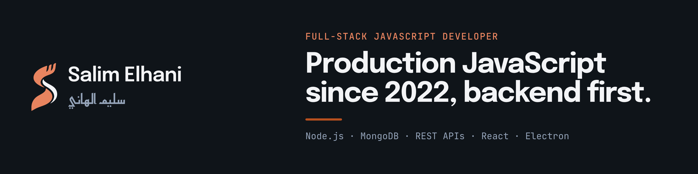

  

  
  
  
  

## About me

I'm a full-stack JavaScript developer with 4+ years of production experience in a small product team. I own features end to end: backend logic, MongoDB data models, third-party integrations, the front end, and the end-to-end tests that keep releases safe.

- **Now:** Full-Stack JavaScript Developer at PerfectSoft, Sfax, since June 2022
- **Building:** [Quran Association Manager](https://github.com/SalimElheni1/quran-association-manager), a desktop app in daily production use
- **Before software:** seven years of computer-vision research in C++ / OpenCV, four of them also teaching engineering students
- **Languages:** Arabic (native), French, English

## Featured project

### [Quran Association Manager](https://github.com/SalimElheni1/quran-association-manager)

An offline-first desktop application that replaced the paper-based administration of a Quranic association branch.

- Modules for students, teachers, classes, attendance, finances and cross-module reporting
- Authentication, role-based access control, full Arabic right-to-left interface, local SQLite storage, PDF / Word / Excel export and backups
- Financial module with automatic fees, numbered receipts, legal cash limits and fixed-format reports
- First commit to first production release in 17 days; in daily use since August 2025 and actively maintained

**Stack:** Electron · React · SQLite &nbsp;|&nbsp; **License:** source-available (CC BY-NC-SA 4.0)

## Selected work at PerfectSoft

Client code is private, so here is what the work covered across two client products:

- Calendar integration connecting Google Calendar, Outlook and iCloud to backend scheduling logic
- Stripe payment and Chargebee subscription workflows, built from scratch
- Cypress end-to-end suite protecting checkout and onboarding flows
- D3.js data visualizations, IndexedDB-based offline handling and interactive onboarding
- Ongoing migration of a legacy PHP platform to MeteorJS / React and Next.js

## Other repositories

| Project | What it is | Stack |
| --- | --- | --- |
| [louage-system](https://github.com/SalimElheni1/louage-system) | Booking app for Tunisian louage shared taxis: trip search, seat reservation, driver schedules, station admin. In progress. | React, Redux Toolkit, Express, MongoDB |
| [proshop-demo](https://github.com/SalimElheni1/proshop-demo) | Full eCommerce platform (cart, reviews, JWT auth, admin), built while following Brad Traversy's MERN course | MongoDB, Express, React, Node.js |
| [ImageScalling](https://github.com/SalimElheni1/ImageScalling) | Image upscaling with Catmull-Rom spline and bicubic interpolation, from my research years | C++ |

## Tech stack

  
  
  
  
  
  
  
  

- **Daily, in production:** JavaScript, MeteorJS, Blaze, Node.js, MongoDB, REST APIs, Cypress, Git
- **Shipped with:** React, Electron, SQLite, D3.js, IndexedDB, Stripe API, Chargebee API, Arabic RTL interfaces
- **Familiar:** React Native, TypeScript, Next.js, PostgreSQL / SQL, Linux
- **Research era:** C++ / OpenCV, C# / EmguCV, VHDL

## Get in touch

The best way to reach me is [LinkedIn](https://www.linkedin.com/in/salimelheni1/) or [email](mailto:elheni.selim@gmail.com). I'm open to remote full-stack and backend roles.
